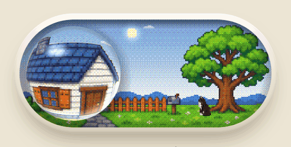

[Try it live](https://yebei199.github.io/unicat-switch/) — click it, or grab the glass ball and drag it slowly.

# unicat-switch

A day/night toggle. The pill-shaped track holds a pixel-art yard, and the thumb is a glass ball that refracts the scene
behind it. Click (or drag) and the sun sets, the sky passes through dusk into night, the window lights up, and the
tuxedo cat walks from the tree back to the doorstep. Click again: morning comes and the cat walks back to the tree.

## Run

```sh
bun install      # dev dependencies are only @types/bun and playwright-core (for recording the GIF)
bun run dev      # dev server, http://localhost:3000 by default
bun run build    # static build into dist/
bun run check    # tsc + biome
bun run record   # re-record docs/demo.gif (frame-stepped screenshots; needs Chrome and ffmpeg)
```

## How it works

| Layer | Files | What it does |
|---|---|---|
| Scene | `src/scene.ts`, `src/sky.ts` | Composites a 224×96 float canvas: sky gradient, sun, moon, stars, clouds, the relit foreground, lamplight, the cat |
| Dither | `src/dither.ts` | 4×4 Bayer ordered dithering, quantized in gamma space; the dotted sky bands and grainy glow come from here |
| Glass | `src/glass.ts` | WebGL: nearest-neighbour upscale, pill mask and inner shadow, spherical refraction via `asin(r)` with chromatic split, fresnel and specular |
| Motion | `src/main.ts`, `src/spring.ts` | An underdamped spring drives the ball (it overshoots), a slower critically damped one drives the sky; velocity-based squash and stretch, the ball leans toward the cursor on hover and shrinks when pressed. Drag slowly and the sky follows the ball; on release a fast flick goes by direction, otherwise to the nearer side |
| Character | `src/cat.ts` | The cat walking between the tree and the doorstep |

A single time parameter `t` (0 day → 0.5 dusk → 1 night) drives everything: sky, lighting, page background and the
bezel glow are all functions of it (`src/daylight.ts`).

## Art

`art/src/` holds the originals generated with Codex (`image_gen`) on a magenta key, with the cat drawn from our tuxedo-cat
design sheets. `bun run art` uses ImageMagick to key out the background, area-downscale, harden the alpha edge and reduce
the palette into `art/*.png`. At 18 px tall the cat turns to mush, so contrast is boosted first and colors are mapped to
a fixed seven-color cat palette. Object coordinates (window, door, tree) in `src/layout.ts` were measured on the
processed `art/scene.png`; re-measure them after regenerating the scene.

With `prefers-reduced-motion`, the springs become critically damped and stop bouncing.

## Slint

`slint/` is the same switch as a Rust crate, `unicat-switch-slint`, for [Slint](https://slint.dev) apps. The scene,
dither and glass are ported file by file and computed on the CPU into a pixel buffer, so it runs on every Slint
renderer (software, FemtoVG, Skia) without shaders. Against the web version it differs by under 0.02/255 mean RGB in
the day, dusk and night states (`slint/compare/`).

```sh
cd slint
cargo run --example demo   # a window with the switch
cargo test                 # unit tests and a headless component test
```

The frame timer runs only while a spring is moving, so an idle switch costs no CPU. One consequence: unlike the web
version, the clouds and stars don't drift while it sits still. A frame at 270 px wide takes about 4 ms on one core at
2× scale. The crate embeds `../art`, so use it as a git or path dependency.

## License

MIT, see `LICENSE`. Covers both the code and the images in `art/`.

<sub>Inspired by [a demo video by @Lattice_Node](https://x.com/Lattice_Node/status/2119392949813555224); code and art are independent work.</sub>
